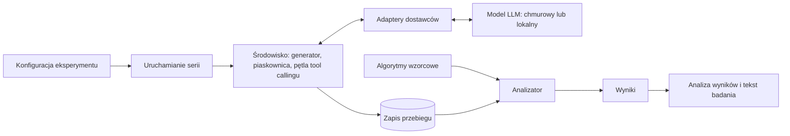

# AlgoTraceUR

**AlgoTrace: jakimi algorytmami modele językowe rozwiązują zadania przez tool calling.** Projekt badawczy Koła
Naukowego Informatyków Uniwersytetu Rzeszowskiego, rok akademicki 2026/2027 (nazwa robocza).

Modele LLM różnych dostawców rozwiązują proste zadania algorytmiczne (sortowanie, wieże Hanoi, wyszukiwanie
w posortowanej tablicy), nie widząc danych: każdy ruch to wywołanie narzędzia (`compare(i, j)`, `swap(i, j)`,
`move(from, to)`, `read(index)`), a każde wywołanie trafia do zapisu przebiegu. Analizator porównuje ten zapis
z algorytmami wzorcowymi uruchomionymi na tych samych danych i rozpoznaje strategię: znany algorytm, hybrydę albo
strategię nową.

## Pytania badawcze

1. **Skuteczność:** jak odsetek poprawnie rozwiązanych zadań zależy od modelu, dostawcy i rozmiaru zadania N?
2. **Algorytm:** jakie algorytmy modele faktycznie wykonują: znane, ich mieszanki czy własne strategie?
3. **Deklaracja a wykonanie:** czy algorytm zapowiedziany w tekście zgadza się z wykonanym?
4. **Efektywność:** ile porównań i zamian zużywa model wobec granic teoretycznych i algorytmów wzorcowych?
5. **Zmiana strategii:** czy model zmienia algorytm, gdy rośnie N albo gdy narzędzie zwróci błąd?

## Jak łączą się części

Moduły łączą się tylko przez pliki o formatach opisanych w `schemas/` (konfiguracja, zapis przebiegu, wyniki), więc
każdy moduł może powstać w innym języku.

## Struktura repozytorium

| Folder | Co tam trafi |
|---|---|
| `docs/` | dokumentacja projektu: decyzje, protokół eksperymentu, notatki ze spotkań |
| `schemas/` | formaty danych wspólne dla wszystkich modułów (kontrakt danych) |
| `src/environment/` | środowisko: generator zadań z ziarnem, piaskownica z ukrytym stanem, pętla tool callingu |
| `src/adapters/` | adaptery dostawców modeli za jednym wspólnym interfejsem |
| `src/runner/` | uruchamianie serii eksperymentów z pliku konfiguracji |
| `src/references/` | algorytmy wzorcowe z zapisem kroków i generator syntetycznych przebiegów |
| `src/analyzer/` | analizator przebiegów: cechy, miary, odległość od wzorców, klasyfikacja strategii |
| `src/analysis/` | analiza wyników: statystyka, tabele i wykresy do tekstu badania |
| `tests/` | testy modułów i danych testowych |
| `experiments/` | zapisane konfiguracje eksperymentów (pilotaż, pełne badanie) |
| `data/` | dane: syntetyczne przebiegi, zapisy przebiegów modeli, wyniki |
| `paper/` | tekst badania w LaTeX |

Każdy folder ma własne `README.md` z opisem, co do niego należy.

Dla zespołu i agentów kodujących: zasady pracy i kolejność czytania w [AGENTS.md](AGENTS.md), przegląd projektu, plan prac i specyfikacje programów w [docs/README.md](docs/README.md).

## Stan

20.11.2026: projekt gotowy do pisania kodu; kodu programów jeszcze nie ma.

- Gotowe: projekt badania i zestaw modeli ([docs/project/overview.md](docs/project/overview.md)), plan prac
  ([docs/project/work-plan.md](docs/project/work-plan.md)), stos technologiczny i licencje
  ([docs/decisions/](docs/decisions/README.md)), protokół eksperymentu w wersji „przed pilotażem”
  ([docs/protocol/](docs/protocol/README.md)), kontrakt danych v2 ([schemas/](schemas/README.md)), specyfikacje
  sześciu programów ([docs/README.md](docs/README.md)), szablon tekstu badania w LaTeX ([paper/](paper/README.md)).
- Następne: algorytmy wzorcowe (`src/references/`), początek analizatora i adapterów; środowisko bazowe trafia do
  `src/environment/` po przejęciu (plan prac, sekcja 4).
- Otwarte: sprawy interfejsów do rozstrzygnięcia przez zespół
  ([docs/project/open-questions.md](docs/project/open-questions.md)).

## Zasady

- **Żadnych kluczy API w repozytorium.** Klucze tylko w zmiennych środowiskowych; konfiguracja podaje nazwę
  zmiennej, nie klucz.
- Każdy przebieg ma być powtarzalny z zapisanej konfiguracji (ziarno, model i jego wersja, ustawienia, data).
- Pliki tekstowe w UTF-8 z końcami linii LF (`.editorconfig`, `.gitattributes`).

## Licencja

| Część repozytorium | Licencja | Gdzie opis |
|---|---|---|
| kod i wszystko poza `data/` i `paper/` (także `docs/`, `schemas/`, `experiments/`) | Apache License 2.0 (`Apache-2.0`) | `LICENSE`, nota w `NOTICE` |
| zbiór przebiegów: `data/` | CC0 1.0 Universal (`CC0-1.0`) | `data/README.md` |
| tekst badania: `paper/` | CC BY 4.0 (`CC-BY-4.0`) | `paper/README.md` |

Prawa autorskie mają autorzy (lista w historii Gita); koło może prezentować projekt, ale nie jest właścicielem praw.
Wkład przesłany do repozytorium jest na licencji części, której dotyczy: kod na Apache-2.0 (tak mówi też § 5 tej
licencji), wkład do `data/` na CC0 1.0, do `paper/` na CC BY 4.0. Powody wyboru i odrzucone opcje:
`docs/decisions/0002-licencje.md`.
