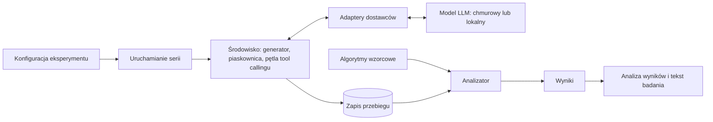

# AlgoTraceUR

**AlgoTrace: jakimi algorytmami modele językowe rozwiązują zadania przez tool calling.** Projekt badawczy Koła
Naukowego Informatyków Uniwersytetu Rzeszowskiego, rok akademicki 2026/2027 (nazwa robocza).

Modele LLM różnych dostawców rozwiązują proste zadania algorytmiczne (sortowanie, wieże Hanoi, wyszukiwanie
w posortowanej tablicy), nie widząc danych: każdy ruch to wywołanie narzędzia (`compare(i, j)`, `swap(i, j)`,
`move(from, to)`, `read(index)`), a każde wywołanie trafia do zapisu przebiegu. Analizator porównuje ten zapis
z algorytmami wzorcowymi uruchomionymi na tych samych danych i rozpoznaje strategię: znany algorytm, hybrydę albo
strategię nową.

## Pytania badawcze

1. **Skuteczność:** jak odsetek poprawnie rozwiązanych zadań zależy od modelu, dostawcy i rozmiaru zadania N?
2. **Algorytm:** jakie algorytmy modele faktycznie wykonują: znane, ich mieszanki czy własne strategie?
3. **Deklaracja a wykonanie:** czy algorytm zapowiedziany w tekście zgadza się z wykonanym?
4. **Efektywność:** ile porównań i zamian zużywa model wobec granic teoretycznych i algorytmów wzorcowych?
5. **Zmiana strategii:** czy model zmienia algorytm, gdy rośnie N albo gdy narzędzie zwróci błąd?

## Jak łączą się części

Moduły łączą się tylko przez pliki o formatach opisanych w `schemas/` (konfiguracja, zapis przebiegu, wyniki), więc
każdy moduł może powstać w innym języku.

## Struktura repozytorium

| Folder | Co tam trafi |
|---|---|
| `docs/` | dokumentacja projektu: decyzje, protokół eksperymentu, notatki ze spotkań |
| `schemas/` | formaty danych wspólne dla wszystkich modułów (kontrakt danych) |
| `src/environment/` | środowisko: generator zadań z ziarnem, piaskownica z ukrytym stanem, pętla tool callingu |
| `src/adapters/` | adaptery dostawców modeli za jednym wspólnym interfejsem |
| `src/runner/` | uruchamianie serii eksperymentów z pliku konfiguracji |
| `src/references/` | algorytmy wzorcowe z zapisem kroków i generator syntetycznych przebiegów |
| `src/analyzer/` | analizator przebiegów: cechy, miary, odległość od wzorców, klasyfikacja strategii |
| `src/analysis/` | analiza wyników: statystyka, tabele i wykresy do tekstu badania |
| `tests/` | testy modułów i danych testowych |
| `experiments/` | zapisane konfiguracje eksperymentów (pilotaż, pełne badanie) |
| `data/` | dane: syntetyczne przebiegi, zapisy przebiegów modeli, wyniki |
| `paper/` | tekst badania w LaTeX |

Każdy folder ma własne `README.md` z opisem, co do niego należy.

## Stan

Listopad 2026: przygotowanie projektu. Jest szkielet repozytorium i szablon tekstu badania; kodu jeszcze nie ma.

- Ustalone: tekst badania powstaje w LaTeX (`paper/`).
- Otwarte, do ustalenia w trakcie: języki programowania i frameworki modułów, dostawcy i modele, licencje.

## Zasady

- **Żadnych kluczy API w repozytorium.** Klucze tylko w zmiennych środowiskowych; konfiguracja podaje nazwę
  zmiennej, nie klucz.
- Każdy przebieg ma być powtarzalny z zapisanej konfiguracji (ziarno, model i jego wersja, ustawienia, data).
- Pliki tekstowe w UTF-8 z końcami linii LF (`.editorconfig`, `.gitattributes`).

## Licencja

Do ustalenia przez autorów (kod, zbiór przebiegów i tekst badania osobno).
