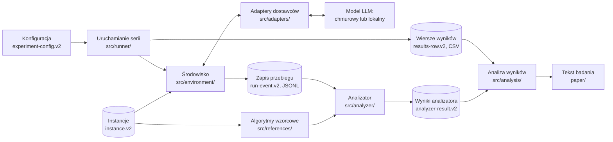

# Przegląd projektu badania

Dla członka zespołu i jego agenta kodującego: co badamy, jak, czym i za ile, zanim zaczniesz czytać specyfikacje.
Ten plik daje całość w kilku minutach i niczego nie ustala: liczby, teksty i reguły są w
[protokole](../protocol/README.md) i w [schematach](../../schemas/README.md), a tu tylko je streszczamy i wskazujemy
sekcje. Gdy dokumenty się różnią, wygrywa protokół (zachowanie, liczby) i schematy (nazwy pól i wartości).

## 1. Po co to badanie

Sprawdzamy, **jak skutecznie** i **jakim algorytmem** modele językowe różnych dostawców rozwiązują proste zadania
algorytmiczne, gdy nie widzą danych i działają wyłącznie przez wywołania narzędzi. Pięć pytań badawczych (skuteczność,
algorytm, deklaracja a wykonanie, efektywność, zmiana strategii) jest w [README.md](../../README.md) w głównym folderze
repozytorium; plan ich analizy jest w [analysis-plan.md](../protocol/analysis-plan.md).

Różnica względem pracy „The Illusion of Thinking” (arXiv 2506.06941): tam model podaje całą listę ruchów w tekście,
u nas każdy ruch to osobne wywołanie narzędzia. Nie ma więc limitu długości odpowiedzi, model nie „obejdzie” zadania
napisaniem programu, a przebieg jest zapisany krok po kroku i da się z niego rozpoznać strategię.

## 2. Zadania i narzędzia

| Zadanie | Narzędzia | Rozmiary | Granica teoretyczna |
|---|---|---|---|
| sortowanie permutacji `1..N` | `compare(i, j)`, `swap(i, j)`, `done` | N = 5, 10, 20 | co najmniej `ceil(log2(N!))` porównań: 7, 22, 62 |
| wieże Hanoi, n krążków | `move(from_peg, to_peg)`, `done` | n = 3, 4, 5 | `2^n - 1` ruchów |
| wyszukiwanie w posortowanej tablicy | `read(index)`, `done(index)` (pozycja albo `-1`) | N = 15, 63, 255 | `ceil(log2(N + 1))` odczytów |

Rozmiary i powody ich wyboru: [design.md](../protocol/design.md) §1. Dokładne nazwy argumentów i schematy narzędzi:
[prompts.md](../protocol/prompts.md) §8.

**Ukryty stan.** Model dostaje tylko rozmiar, cel i zasady ([prompts.md](../protocol/prompts.md) §4). Wartości
sortowanej tablicy ani tablicy do przeszukania nie widzi: poznaje je przez wyniki wywołań (`compare` zwraca, czy
element na pozycji `i` jest mniejszy, czy większy; `read` zwraca liczbę z pozycji). W Hanoi stanu po ruchach też mu nie
podajemy, więc musi go śledzić sam. Instancje są losowane z ziarna, jedna ta sama dla wszystkich modeli, i leżą w
pliku `instances/<series>.jsonl` ([design.md](../protocol/design.md) §3).

## 3. Przebieg jednego zadania

Przebieg ma stały schemat ([prompts.md](../protocol/prompts.md) §2):

1. Wiadomość systemowa (jedna dla wszystkich zadań) i opis zadania z wartościami instancji, po angielsku. Opis jest
   neutralny: nie podpowiada żadnego algorytmu. Teksty bierzemy dosłownie z protokołu, kod ich nie poprawia.
2. Definicje narzędzi w każdym zapytaniu, `tool_choice: auto`.
3. **Zapowiedź algorytmu.** Opis kończy się prośbą, by przed pierwszym wywołaniem model w jednym zdaniu napisał, jakie
   podejście zastosuje. Surowy tekst trafia do zapisu i służy pytaniu 3 ([prompts.md](../protocol/prompts.md) §6).
4. Pętla: odpowiedź modelu, wykonanie wywołań po kolei (jedna tura może mieć kilka wywołań), wyniki wracają do modelu
   w następnym zapytaniu. Wywołanie niepoprawne nie zmienia stanu, a jego wynik tłumaczy błąd.
5. Odpowiedź bez wywołania dostaje krótkie przypomnienie.

**Koniec przebiegu.** Model kończy go narzędziem `done`; środowisko samo nie kończy po osiągnięciu celu (to byłaby
podpowiedź), a `solved` zapisuje niezależnie od `done`. Przebieg może też skończyć się z innego powodu; zamknięta lista
`end_reason` (10 wartości, m.in. `done_solved`, `done_unsolved`, `step_limit`, `too_many_errors`, `no_tool_call`,
`api_error`, `cost_limit`) jest w [run-settings.md](../protocol/run-settings.md) §8. Limity kroków (np. 135 dla
sortowania N = 10, 45 dla Hanoi n = 4) i błędów z rzędu: tamże §3-4. Za sukces w analizie głównej uznajemy
`done_solved`, czyli model sam ogłosił koniec przy poprawnym stanie ([analysis-plan.md](../protocol/analysis-plan.md)
§1).

Każde zdarzenie (start, tura modelu, wywołanie narzędzia, koniec) trafia do zapisu przebiegu w JSONL, zgodnego z
`schemas/run-event.v2.schema.json`.

## 4. Rozpoznawanie algorytmu

Analizator nie czyta tekstu modelu, tylko ciąg wykonanych operacji. Jego trzy kroki ([classification-rules.md](../protocol/classification-rules.md) §3-6):

1. **Wzorce.** Program `src/references/` uruchamia na tej samej instancji algorytmy wzorcowe i zapisuje ich ciągi
   operacji. Sortowanie: bąbelkowe, koktajlowe, przez wstawianie, przez wybór, szybkie, scalanie w miejscu, każde w
   wariantach (kierunek, wczesne zakończenie, wybór osi). Wyszukiwanie: połowienie, interpolacja, liniowe, skokowe,
   wykładnicze. Hanoi ma jedno rozwiązanie optymalne.
2. **Cechy i odległość.** Z zapisu liczy się cechy przebiegu (m.in. odsetek porównań i zamian sąsiadów, stosunek zamian
   do porównań, liczba porównań przed pierwszą zamianą) oraz znormalizowaną odległość Levenshteina między ciągiem
   modelu a każdym wzorcem. Próg odległości `tau_N` jest osobny dla każdego N, kalibrowany na przebiegach
   syntetycznych i zamrożony przed pełnym badaniem.
3. **Etykieta.** Najbliższy wzorzec w progu daje algorytm znany; gdy nie mieści się w progu, ślad dzieli się na odcinki
   i szuka hybrydy; inaczej to strategia nowa.

Pułapka warta znajomości: sortowanie bąbelkowe i przez wstawianie wykonują tę samą liczbę zamian (równą liczbie
inwersji), więc odróżnia je kolejność operacji, nie ich liczba.

**Etykiety** (pole `label` w `schemas/analyzer-result.v2.schema.json`; pełne reguły:
[classification-rules.md](../protocol/classification-rules.md) §1-2):

| Rodzina | Etykiety |
|---|---|
| sortowanie | `known:<algorytm>`, `hybrid:<A>+<B>`, `ambiguous:<A>\|<B>`, `new:info_first`, `new:other`, `failed:<typ>` |
| Hanoi | `optimal`, `optimal_detours`, `other`, `failed:<typ>` |
| wyszukiwanie | `known:<wzorzec>`, `ambiguous:<A>\|<B>`, `other`, `too_short`, `failed:<typ>` |

`ambiguous` znaczy, że dwa wzorce są niemal tak samo bliskie. `new:info_first` to hipoteza: model zadaje wiele
porównań bez zamiany, a potem wykonuje zamiany w liczbie bliskiej minimum, jakby ustalił kolejność „w głowie”.
`failed:<typ>` dostaje przebieg bez stanu docelowego, a `failed:infra` brak danych z winy infrastruktury. W schemacie
etykieta ma tekst (`text`) i pola `kind`, `algorithms`, `variant`, `subtype`, `failure_detail`; nazwy algorytmów to
identyfikatory w rodzaju `bubble_sort`, `insertion_sort`, `binary_search`.

Przed badaniem analizator musi rozpoznać syntetyczne przebiegi wzorców (także z zakłóceniami) z trafnością, której
dolna granica przedziału ufności wynosi co najmniej 0,95 ([classification-rules.md](../protocol/classification-rules.md) §11).

## 5. Miary

Definicje i estymatory: [analysis-plan.md](../protocol/analysis-plan.md) §1 i §3-7.

- **Skuteczność:** odsetek przebiegów `done_solved` z przedziałem Wilsona, na model, zadanie i rozmiar; modelem
  głównym jest GEE z klastrem po treści instancji. Porażki modelu i braki danych (`api_error`, `time_limit`,
  `cost_limit`, `interrupted`) liczy się osobno.
- **Porównania:** liczba wobec `ceil(log2(N!))` i wobec najbliższego wzorca; porównania zbędne to takie, których wynik
  wynikał już z wcześniejszych przez przechodniość (liczone na grafie relacji między elementami, nie indeksami, bo
  zamiany przesuwają elementy).
- **Zamiany:** liczba wobec liczby inwersji i wobec `N - (liczba cykli permutacji)`. W Hanoi ruchy wobec `2^n - 1` i
  cofnięcia, w wyszukiwaniu odczyty wobec `ceil(log2(N + 1))` i odczyty zbędne.
- **Zgodność deklaracji:** czy algorytm zapowiedziany w tekście (kodują dwie osoby niezależnie) zgadza się z
  rozpoznanym; zgodność surowa, kappa Cohena i macierz pomyłek.
- **Błędy:** wywołania odrzucone przez walidację według rodzaju, przebiegi przerwane limitem; pomocniczo tokeny, czas i
  koszt.

## 6. Warunki eksperymentu i zestaw modeli

Układ badania: [design.md](../protocol/design.md).

| Etap | Co | Przebiegi |
|---|---|---|
| pilotaż (seria `pilot`) | 3 modele darmowe i lokalne; próba wszystkich komórek oraz grupy porównujące warianty tekstów (bez prośby o zapowiedź, parafrazy, temperatura, Hanoi ze stanem, symbole w `compare`, błędy) | 277 |
| badanie główne (`condition: main`) | 7 modeli x 3 zadania x 3 rozmiary x 10 powtórzeń; bez błędów wstrzykniętych | 630 |
| warunek z błędami (`condition: faults`) | 7 modeli, sortowanie N = 10 i Hanoi n = 4, 10 powtórzeń, błąd `one_off` albo `persistent` | 280 |

Każde powtórzenie ma własną instancję (wyjątek: Hanoi ma jeden stan początkowy), te same instancje dostają wszystkie
modele, a kolejność przebiegów u dostawcy jest losową permutacją z ziarna ([design.md](../protocol/design.md) §3-4).
Pilotaż ma inne ziarno bazowe niż badanie główne i służy do strojenia ustawień według z góry spisanych reguł
(§6 tamże); potem protokół jest zamrażany i rejestrowany przed pierwszym przebiegiem pełnego badania. Pełne badanie ma
się zakończyć do 31.05.2027.

**Wstrzykiwanie błędów** służy pytaniu 5 (czy model zmienia strategię po błędzie narzędzia). Środowisko, zgodnie z
harmonogramem z ziarnem, odrzuca wybrane poprawne wywołanie komunikatem o błędzie: raz (`one_off`) albo przez kilka
kolejnych wywołań (`persistent`). Kontrolą jest przebieg tego samego modelu na tej samej instancji bez błędu. Typy,
harmonogram i komunikat: [fault-injection.md](../protocol/fault-injection.md).

**Zestaw modeli (zestaw A, 7 modeli, 4 dostawców chmurowych i jeden lokalny).** Ustawienia każdego modelu (tryb
rozumowania, parametry, `max_tokens`) są w [run-settings.md](../protocol/run-settings.md) §2. Jeden stały tryb
rozumowania na model; temperatury nie ustawiamy.

| Model | Dostawca | Rozumowanie |
|---|---|---|
| `claude-sonnet-5-5` | Anthropic | zawsze, najniższy poziom |
| `claude-haiku-5-5` | Anthropic | wyłączone |
| `gpt-6.1-terra` | OpenAI | wyłączone |
| `gpt-6-luna` | OpenAI | wyłączone |
| `gemini-4-hydrogen` | Google (Gemini) | zawsze, najniższy poziom |
| `openai/gpt-oss-120b` | Groq | niski poziom |
| `qwen3:8b` | Ollama, lokalnie | wyłączone |

Skład wybrano w listopadzie 2026 i **może się zmienić** (np. wycofanie modelu przez dostawcę); obowiązuje to, co
mówi [run-settings.md](../protocol/run-settings.md). Pilotaż używa tylko `gemini-4-hydrogen` (plan darmowy),
`openai/gpt-oss-120b` (plan darmowy) i `qwen3:8b`; modele Anthropic i OpenAI wchodzą dopiero do pełnego badania, gdy
powstaną konta płatne.

## 7. Koszt i budżet

Każde zapytanie niesie całą dotychczasową rozmowę, więc liczba tokenów wejścia rośnie z kwadratem liczby kroków.
Przykład: przebieg 200 kroków to około 1,7 mln tokenów wejścia. Dlatego **cache promptu jest wymogiem**: prefiks
rozmowy musi być stały, a adaptery nie mogą go zmieniać między krokami. Z cache koszt modeli z rozumowaniem to w
większości tokeny wyjścia (rozumowanie), więc budżet zależy bardziej od ich liczby na krok niż od cen wejścia.

Rząd wielkości według [design.md](../protocol/design.md) §5 (koszt umowny po cennikach płatnych z 19.11.2026):

- jeden przebieg: od ułamka centa (`claude-haiku-5-5`, `gpt-6-luna`) po około 5 USD w najgorszym przypadku
  (`gemini-4-hydrogen`, sortowanie N = 20);
- pełne badanie (910 przebiegów z możliwymi dodatkami po pilotażu): górny koszt około 281 USD, typowy około 100 USD;
  rekomendowany `budżet_serii` około 340-390 USD z zapasem na powtórzenia po błędach API;
- pilotaż: modele na planach darmowych i lokalnie, więc rzeczywiście 0 USD, ale limity dzienne mogą rozciągnąć go w czasie.

Liczby opierają się na założeniach (80 tokenów na krok, 540 tokenów wyjścia z rozumowaniem), które pilotaż zastępuje
pomiarem. **Kto pilnuje:** budżet serii ustala człowiek (właściciel) w konfiguracji; program `src/runner/` ma strażnika
([run-settings.md](../protocol/run-settings.md) §7), który nie startuje przebiegu przy przekroczeniu budżetu i kończy
go z `cost_limit`. Agent kodujący nie uruchamia niczego, co woła płatne API, bez zgody człowieka ([AGENTS.md](../../AGENTS.md)).

## 8. Przepływ danych

Jak czytać: lewa część to wykonanie. Seria czyta konfigurację i uruchamia przebiegi; środowisko trzyma ukryty stan i
wykonuje wywołania narzędzi, a adapter tłumaczy rozmowę na API konkretnego dostawcy. Wszystko, co przechodzi przez pętlę,
trafia do zapisu przebiegu. Prawa część to analiza po fakcie: wzorce są liczone na tych samych instancjach, analizator
zestawia je z zapisem, a analiza wyników bierze etykiety, miary i wiersze wyników.

Programy łączą się **tylko plikami** zgodnymi ze `schemas/*.v2.schema.json`, a programy .NET dodatkowo interfejsem
`IChatClient` ([0001-stos-technologiczny.md](../decisions/0001-stos-technologiczny.md)). Dlatego część w C# (środowisko,
adaptery, seria) i część w Pythonie (wzorce, analizator, analiza) mogą powstawać niezależnie. Środowisko bazowe
(piaskownica, pętla, błędy) powstaje jako projekt zaliczeniowy lidera i trafia do `src/environment/` po jego oddaniu
(po 23.12.2026); do tego czasu pozostałe programy pracują na atrapie, czyli przykładach z `schemas/examples/`.
Lista schematów i przykładów: [schemas/README.md](../../schemas/README.md).

## 9. Gdzie dalej

- [work-plan.md](work-plan.md): kolejność programów, zależności, kryteria „gotowe”.
- Specyfikacje programów: [environment.md](../specs/environment.md), [adapters.md](../specs/adapters.md),
  [runner.md](../specs/runner.md), [references.md](../specs/references.md), [analyzer.md](../specs/analyzer.md),
  [analysis.md](../specs/analysis.md).
- Wiedza o API dostawców: [provider-apis.md](../knowledge/provider-apis.md).
- Protokół: [README.md](../protocol/README.md) (mapa plików i zgodność ze schematami).
- Zasady pracy i kolejność czytania: [AGENTS.md](../../AGENTS.md), [docs/README.md](../README.md).
