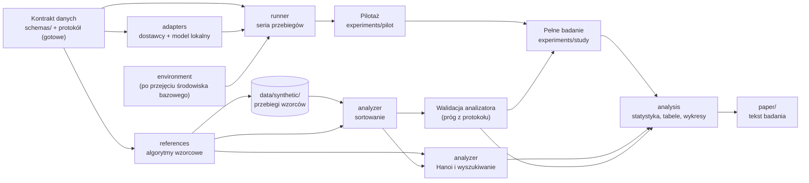

# Plan prac

Kolejność powstawania programów, zależności między nimi, sprawdzalne kryteria „gotowe” i etapy badania. Opis
projektu badawczego (metoda, miary, modele, koszt) jest w [overview.md](overview.md). Zasady pracy w repozytorium:
[AGENTS.md](../../AGENTS.md).

## 1. Zasada pracy

- **Jeden program = jedna gałąź = (jeśli się da) jeden PR.** Gałąź nazywa się `<program>/<krótki-opis>`, np.
  `references/sortowanie-wzorce`. Opis PR mówi, co i dlaczego, który punkt specyfikacji z `docs/specs/` realizuje i jak
  sprawdzono.
- **Kontrakt danych to jedyne połączenie programów.** Programy wymieniają się plikami zgodnymi ze `schemas/*.v2.schema.json`
  ([schemas/README.md](../../schemas/README.md)); programy .NET łączą się dodatkowo przez `IChatClient`
  ([0001](../decisions/0001-stos-technologiczny.md)). Nikt nie importuje kodu innego programu, więc programy można pisać
  równolegle.
- **Protokół i schematy są ustalone.** Programy ich nie zmieniają; zmiana wymaga decyzji zespołu (AGENTS.md, sekcja
  „Czego agent nie robi sam”).
- **Testy bez płatnych API.** Modele zastępuje fałszywy `IChatClient` albo atrapa HTTP.
- **Środowisko bazowe** powstaje jako osobny projekt zaliczeniowy lidera i trafia do `src/environment/` po jego oddaniu
  (po 23.12.2026). Do tego czasu nikt nie pisze kodu w tym folderze (sekcja 4).

## 2. Kolejność i zależności

Strzałka `A --> B` znaczy: B potrzebuje wyniku A, żeby zostać skończone w pełni (na atrapie można zacząć wcześniej).

**Od razu równolegle** (zależą tylko od kontraktu danych): `references/`, `adapters/`, początek `runner/` (czytanie
konfiguracji, wznawianie, budżet, na atrapie środowiska) oraz tekst badania w `paper/`. Zaraz po wzorcach startuje
`analyzer/` dla sortowania. Czekają na środowisko: `runner/` w całości (przebieg od początku do końca), pilotaż i pełne
badanie. Analizator wież Hanoi i wyszukiwania potrzebuje wzorców i metody sortowania, ale nie środowiska. Skrypty
`analysis/` można pisać wcześniej na danych z pilotażu i syntetycznych.

## 3. Programy: zależności, atrapa, kryterium „gotowe”

Wszystkie polecenia uruchamia się z katalogu głównego repozytorium. Zawsze obowiązuje ogólne sprawdzenie z AGENTS.md
(`dotnet build`, `dotnet test`, `uv sync --locked --all-packages`, `uv run --locked pytest`,
`python -I schemas/check_examples.py`); poniżej to, co dochodzi.

| Program | Co wchodzi | Zależy od | Wcześniej na atrapie | Kryterium „gotowe” |
|---|---|---|---|---|
| `src/references/` | sortowanie (co najmniej 6 algorytmów z wariantami), Hanoi (rekurencja), wyszukiwanie (połowienie, interpolacja, liniowe, skokowe, wykładnicze; lista w [classification-rules.md](../protocol/classification-rules.md)), generator przebiegów z zakłóceniami | kontrakt danych | nie potrzebuje atrapy | `uv run --locked pytest tests/python/references` zielone, w tym `[4, 6, 3, 1, 2]`: bąbelkowe 10 porównań i 8 zamian, przez wstawianie 10 i 8, przez wybór 10 i 2; zapisane przebiegi przechodzą walidację ze `schemas/run-event.v2.schema.json`; ten sam plik i to samo ziarno dają te same bajty |
| `data/synthetic/` | przebiegi wzorców czyste i z zakłóceniami (zbędne porównanie, pominięty krok, zmieniona kolejność), kilka rozmiarów N | `references/` | - | pliki w `data/synthetic/` generowane poleceniem z `src/references/README.md`, każdy zgodny ze schematem, powtarzalne z ziarna |
| `src/analyzer/` (sortowanie) | cechy, miary (w tym porównania zbędne na grafie relacji), odległość od wariantów wzorców, etykieta według [classification-rules.md](../protocol/classification-rules.md) | `references/`, protokół | przebiegi z `schemas/examples/` i `data/synthetic/` | `uv run --locked pytest tests/python/analyzer` zielone; wynik dla `schemas/examples/run.bubble-sort-n5.jsonl` zgodny z `schemas/examples/analyzer-result.bubble-sort-n5.json`; każdy wynik przechodzi `analyzer-result.v2.schema.json`; przebiegi wzorców dostają etykietę `known` ze swoim algorytmem |
| Walidacja analizatora | raport: co najmniej 6 algorytmów z wariantami, przebiegi czyste i z zakłóceniami, kilka N, macierz pomyłek, opis pomyłek | analyzer (sortowanie), `data/synthetic/` | tylko dane syntetyczne | raport w repozytorium (`docs/`), dolna granica 95% przedziału Wilsona trafności co najmniej 0,95 ([classification-rules.md](../protocol/classification-rules.md) §11), skrypt powtarzający pomiar jednym poleceniem, próg i parametry zapisane w protokole (przez decyzję zespołu) |
| `src/analyzer/` (Hanoi i wyszukiwanie) | odchylenie od optimum, ruchy niedozwolone i powroty; ciąg indeksów `read` i liczba odczytów wobec granicy | `references/`, metoda w protokole | przebiegi wzorców Hanoi i wyszukiwania z `references/` | testy na przebiegach wzorcowych obu rodzin zielone; etykiety zgodne z `schemas/` (`optimal`, `optimal_detours`, `other`, `failed`; `known`, `ambiguous`, `other`, `too_short`, `failed`) |
| `src/adapters/` | dostawcy zestawu A ([run-settings.md](../protocol/run-settings.md) §2: Anthropic, OpenAI, Gemini, Groq) i model lokalny w Ollamie za `IChatClient`, bez `UseFunctionInvocation`, ten sam opis narzędzi i prompt, ponowienie z przerwą | kontrakt danych, decyzja 0001 | fałszywy `IChatClient`, atrapa HTTP (`WireMock.Net`) | `dotnet test` dla `tests/dotnet/AlgoTrace.Adapters.Tests/` zielone bez sieci; tokeny, wersja modelu, czas i błędy API trafiają do zapisu; klucz tylko ze zmiennej środowiskowej; różnice między dostawcami opisane w `docs/`; jedno ręczne wywołanie każdego adaptera przez człowieka (z jego kluczem) |
| `src/environment/` | generator zadań z ziarnem, piaskownica z ukrytym stanem, pętla tool callingu, zapis przebiegu | przejęcie środowiska bazowego (po 23.12.2026), kontrakt | - | `tests/dotnet/AlgoTrace.Environment.Tests/` zielone; 3 rodziny zadań sprawdzają stan końcowy; ten sam generator i ziarno dają te same instancje; zapis przebiegu przechodzi walidację `JsonSchema.Net` |
| `src/runner/` | czytanie konfiguracji, seria w tle, wznawianie bez powtarzania gotowych przebiegów, limit kosztu, zapis przebiegów i wierszy CSV | `adapters/`, `environment/` | konfiguracje z `schemas/examples/`, atrapa środowiska, fałszywy `IChatClient` | `tests/dotnet/AlgoTrace.Runner.Tests/` zielone; konfiguracja z kluczem jest odrzucana; po przerwaniu i wznowieniu seria nie dubluje `run_id`; seria staje po przekroczeniu budżetu; `dotnet run --project src/runner -- experiments/<konfiguracja>` daje pliki zgodne ze schematami |
| Pilotaż | konfiguracje w `experiments/pilot/`, 277 przebiegów na 3 modelach (plany darmowe i model lokalny), grupy i reguły rozstrzygnięcia z [design.md](../protocol/design.md) §6 | `runner/`, `environment/`, `adapters/`, protokół | - | zapisy w `data/runs/`, wiersze w `data/results/`, wszystkie przechodzą walidację schematem; kosztorys pełnego badania z pomiaru (wywołania i tokeny na przebieg); poprawki protokołu i lista problemów środowiska i adapterów zapisane w PR |
| Pełne badanie | konfiguracje w `experiments/study/`: seria główna 7 modeli x 3 zadania x 3 rozmiary x 10 powtórzeń = 630 przebiegów i warunek z błędami 280 przebiegów ([design.md](../protocol/design.md) §1-2; minimum z karty projektu: 500) | pilotaż, walidacja analizatora, budżet potwierdzony przez człowieka | - | co najmniej 500 zapisanych przebiegów w `data/runs/` z wersją modelu i datą, wiersze w `data/results/`, koszt w budżecie, dziennik problemów, konfiguracji użytej w badaniu się nie zmienia |
| `src/analysis/` | skuteczność z przedziałami ufności, rozkład algorytmów, deklaracja a wykonanie, efektywność, zmiana strategii z N i po błędzie, tabele i wykresy | wyniki badania, analyzer (wszystkie rodziny), [analysis-plan.md](../protocol/analysis-plan.md) | dane z pilotażu i syntetyczne | `uv run --locked pytest tests/python/analysis` zielone; jedno polecenie odtwarza wszystkie tabele i wykresy do `paper/figures/`; co najmniej 90% udanych przebiegów sortowania ma strategię przypisaną według jawnych reguł; przypadki „nowa strategia” przejrzane ręcznie i opisane |

## 4. Praca przed przejęciem środowiska bazowego

Do oddania środowiska bazowego `src/environment/` jest puste i nikt go nie dotyka. Zespół pracuje na atrapach, które
trzymają się kontraktu danych:

- **Przykłady z `schemas/examples/`** to gotowe wejścia: `run.bubble-sort-n5.jsonl` (19 kroków), `run.api-error-n3.jsonl`
  (próba zakończona `api_error` i zastąpiona próbą 2), `run.edge-cases-n3.jsonl` (kilka wywołań w turze, błędy, limit
  kroków, wywołanie pominięte), `instances.example.jsonl`, `experiment-config.pilot-sort.json`,
  `experiment-config.faults-sort.json`, `results.example.csv`, `analyzer-result.bubble-sort-n5.json`. Parser analizatora,
  czytnik konfiguracji w `runner/` i zapis wyników testuje się na nich; błędne przykłady z `schemas/examples/invalid/`
  muszą być odrzucone.
- **Syntetyczne przebiegi** z `src/references/` zapisane w `data/synthetic/` zastępują przebiegi modeli w `analyzer/`
  i w pierwszych skryptach `analysis/`. Wzorce w czystej postaci mają znaną etykietę, więc służą też jako test.
- **Fałszywy `IChatClient`** (odpowiedzi z listy, w tym wywołania narzędzi, błędy API, brak wywołania w turze) pozwala
  testować `adapters/` i `runner/` bez środowiska i bez sieci. Atrapa środowiska w testach `runner/` zwraca z góry
  przygotowane zapisy przebiegu zgodne ze schematem.
- **Czego nie robić:** nie pisać zastępczego środowiska w `src/environment/`, nie kopiować do repozytorium kodu
  środowiska spoza niego, nie zmieniać schematów, żeby pasowały do atrapy. Gdy atrapa czegoś nie pokrywa, zgłoś to w PR
  jako „do ustalenia”.
- **Po przejęciu:** atrapa zostaje w testach jednostkowych, a w `runner/` dochodzi test całego łańcucha (środowisko z
  fałszywym `IChatClient`, bez płatnych API).

## 5. Etapy badania

Terminy są orientacyjne, liczone w miesiącach; dokładne daty ustala zespół na spotkaniach.

| Okres | Etap | Co ma być skończone na końcu etapu |
|---|---|---|
| Listopad-grudzień 2026 | Start i fundamenty | kontrakt danych i stos technologiczny (gotowe w repozytorium), `references/`, początek `analyzer/` i `adapters/`; lider oddaje środowisko bazowe po 23.12.2026 |
| Styczeń 2027 | Kod do pierwszego kamienia milowego | `src/environment/` w repozytorium, analizator sortowania, **walidacja analizatora z trafnością co najmniej 95%**, adaptery; środowisko z 3 rodzinami zadań |
| Luty-marzec 2027 | Seria i pilotaż | `runner/` na prawdziwym środowisku, analizator Hanoi i wyszukiwania, **pilotaż** z kosztorysem z pomiaru i poprawkami protokołu |
| Kwiecień-maj 2027 | Pełne badanie | konfiguracje `experiments/study/`, przebiegi w krótkim oknie (ciche aktualizacje modeli), **co najmniej 500 przebiegów**, skrypty analizy sprawdzone na pilotażu |
| Maj-czerwiec 2027 | Analiza i tekst | analiza odpowiadająca na 5 pytań badawczych, pełny tekst w `paper/`, publiczny zbiór przebiegów w `data/`, zgłoszenie referatu na konferencję studencką |
| Lipiec 2027 | Zakończenie | prezentacja wyników na spotkaniu koła i raport końcowy |

Pilotaż i pełne badanie wołają płatne API, więc uruchamia je człowiek po potwierdzeniu budżetu, nie agent. Sesje
egzaminacyjne i przerwy w semestrze obniżają tempo (zwłaszcza luty); tryb pracy w tych okresach uzgadnia zespół.

## 6. Jak oznaczyć, że praca jest gotowa

Program jest gotowy, gdy wszystkie punkty są prawdziwe:

1. **Testy.** Przechodzą polecenia z sekcji 3 dla programu i ogólne z AGENTS.md; testy nie wołają sieci ani płatnych API.
2. **Walidacja schematem.** Każdy plik danych, który program zapisuje, przechodzi walidację ze `schemas/*.v2.schema.json`
   w teście, a `python -I schemas/check_examples.py` nadal przechodzi.
3. **Powtarzalność.** Ten sam plik wejściowy i to samo ziarno dają te same bajty wyjścia (poza znacznikami czasu i
   odpowiedziami modeli), co pokazuje test.
4. **README modułu.** Polecenia w `src/<program>/README.md` zostały uruchomione i poprawione tam, gdzie były planem.
5. **Brak sekretów.** W kodzie, przykładach, logach i danych nie ma kluczy API ani danych osobowych.
6. **PR.** Opis wskazuje punkt specyfikacji, sposób sprawdzenia i wszystko oznaczone jako „do ustalenia”; zależności
   spoza decyzji 0001 mają wpis z licencją zgodną z Apache-2.0.
7. **Przegląd.** Co najmniej jedna inna osoba przeglądnęła PR; scala człowiek. Dopiero po scaleniu praca jest
   uznana za gotową, a zależne od niej programy mogą polegać na jej wyniku.
8. **Dane.** Zapisów w `data/` i konfiguracji użytych w badaniu się nie zmienia; poprawka to nowy plik z opisem powodu.
